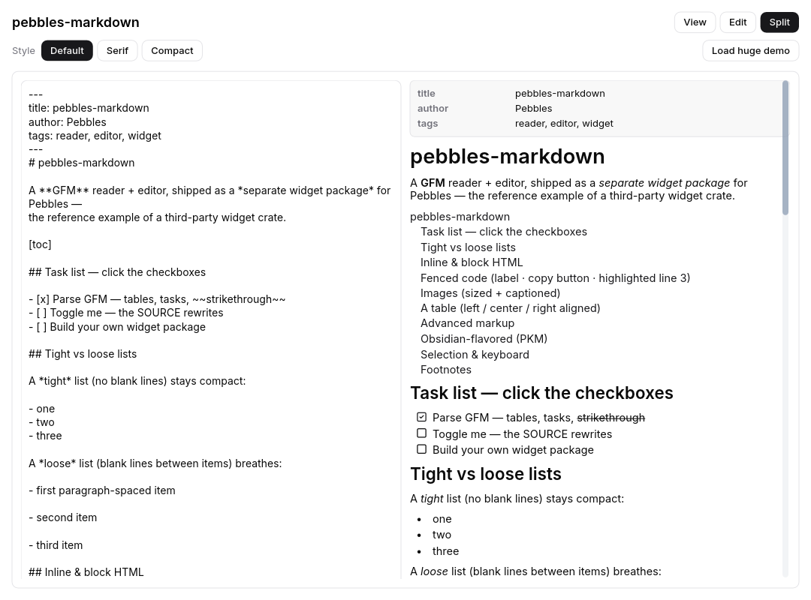

# pebbles-markdown

A live **Markdown reader + editor** widget for the
[Pebbles](https://github.com/pebbles-hq/pebbles) GUI framework, maintained as a
**separate package**.

It is also the reference example of a **third-party Pebbles widget crate**:
it depends only on Pebbles' *public* API and composes the built-in catalog into
new widgets — the same thing any ecosystem package does. If markdown can live
outside the framework as a normal crate, so can your components.



```rust
use pebbles::prelude::*;
use pebbles_markdown::{markdown, markdown_editor, MarkdownMode};

fn notes() -> impl IntoWidget {
    // A read-only rendered document…
    markdown("# Hello\n\n- [x] tasks\n- [ ] tables\n\n`code`, **bold**, *italic*.")
}

fn editor(src: Signal<String>) -> impl IntoWidget {
    // …or a live editor with View / Edit / Split modes you drive by signal.
    markdown_editor(src).mode_signal(create_signal(MarkdownMode::Split))
}
```

Run the showcase — reader + editor with View / Edit / Split modes, themeable
style variants (default / serif / compact), selectable + copyable text, keyboard
link traversal, and the virtualized reader on a deterministic multi-megabyte
stress document:

```sh
cargo run -p demo
# headless screenshot (no display):
SHOT=1080:800:/tmp/markdown.rgba cargo run -p demo
```

## What it does

- **Reading** (`markdown`): full GFM via [`pulldown-cmark`] — headings, emphasis /
  strong / strikethrough, inline + fenced code, clickable links, nested quotes and
  lists, **task lists with live checkboxes** that rewrite the bound source, tables
  (with column alignment + horizontal scroll), rules, footnotes, and images
  (sized + captioned; with the `image-view` feature, alt text otherwise).
- **Advanced markup**: 2-D display math (`$$…$$`) + inline TeX→Unicode, callouts
  (`> [!NOTE]`), `:::` containers, definition lists, `==highlight==`,
  sub/superscript, emoji, smart punctuation, heading slugs + `[toc]`, and
  collapsible `<details>`.
- **Obsidian PKM**: wikilinks + aliases, image/note embeds with resolver
  transclusion + hover preview, `#tags`, `%% comments %%`, a front-matter
  properties panel, and a host-supplied backlinks section.
- **Code blocks**: per-language syntax highlighting (JetBrains Mono, themeable
  palette), a language label, a copy button, opt-in line numbers, and highlighted
  lines (`{2,4-6}`).
- **Editing** (`markdown_editor`): a `Signal<String>`-bound editor with Edit /
  Split / Read modes, driven by a mode signal you own — no built-in chrome — plus
  reusable source-transform helpers (`toggle_task`, `wrap_selection`,
  `toggle_line_prefix`).
- **Interaction & a11y**: clickable + hover-reported links, cross-block text
  **selection + copy** (`selectable`), **keyboard link traversal**
  (`keyboard_links`), find-in-document highlighting, fold-on-click headings, and
  per-block screen-reader semantics.
- **Theming**: everything visual lives in `MarkdownStyle`, defaulting from the
  live Pebbles theme (follows light/dark).
- **Security**: raw HTML is inert (rendered, never executed) and links are
  scheme-allowlisted (`javascript:` / `data:` … render as text).
- **Extensibility**: a fenced-block handler (e.g. map ```` ```mermaid ```` to a
  diagram), a custom per-block renderer, and HTML export (`to_html`).
- **Robust by contract**: any input renders — malformed or unusual constructs
  fall back to plain text instead of crashing (see `tests/robustness.rs`,
  `tests/storm.rs`).
- **Virtualized**: `markdown(..).virtualized()` renders only the blocks in view,
  so a multi-megabyte document stays a few hundred widgets.

## Project layout

The crate is organized **by domain** — a thin `lib.rs` crate root over one module
per concern (`model` · `parse` · `highlight` · `style` · `edit` · `widget` ·
`render` · `editor`, plus `advanced` / `math` / `html` helpers). See
[ARCHITECTURE.md](ARCHITECTURE.md) for the module map and layering rules, and
[CONTRIBUTING.md](CONTRIBUTING.md) to get set up and land a change.

## Depending on Pebbles

This crate needs the Pebbles framework crates. Two supported layouts:

**Local / side-by-side (this repo's default).** Clone `pebbles` and
`pebbles-markdown` as siblings; the `Cargo.toml` path dependencies resolve
against `../pebbles`.

```
some-dir/
  pebbles/            # github.com/pebbles-hq/pebbles
  pebbles-markdown/   # this repo
```

**External consumer (git).** Point at the framework by git — this is how any
ecosystem package (yours included) depends on Pebbles until it is published to a
registry:

```toml
[dependencies]
pebbles          = { git = "https://github.com/pebbles-hq/pebbles" }
pebbles-markdown = { git = "https://github.com/pebbles-hq/pebbles-markdown" }
```

## Building your own Pebbles widget package

This crate is the template. A Pebbles widget package:

1. Depends on `pebbles-core` (the reactive + widget contract: `Signal`,
   `component` / `component_props`, `IntoWidget`, `children!`), `pebbles-widgets`
   (the catalog + `theme()` to compose and match the app's look), and
   `pebbles-render` / `pebbles-foundation` for primitives (`Color`, `TextSpan`,
   layout types). For a genuinely new low-level widget, implement
   `pebbles_render::RenderObject` and bind it with the `render_widget!` macro —
   all public.
2. Exposes plain constructor functions returning `impl IntoWidget` (the Pebbles
   convention — lowercase `markdown(..)`, not `Markdown::new()`), so callers use
   your widget exactly like a built-in one.
3. Never reaches into framework internals — everything here is reachable from the
   public API. If you find a gap, that's a framework bug worth filing upstream.

## License

Licensed under the **Apache License, Version 2.0** — see [LICENSE](LICENSE) and
[NOTICE](NOTICE). The same license as the Pebbles framework.

Copyright © 2026 Reyco Seguma.

[`pulldown-cmark`]: https://github.com/pulldown-cmark/pulldown-cmark
